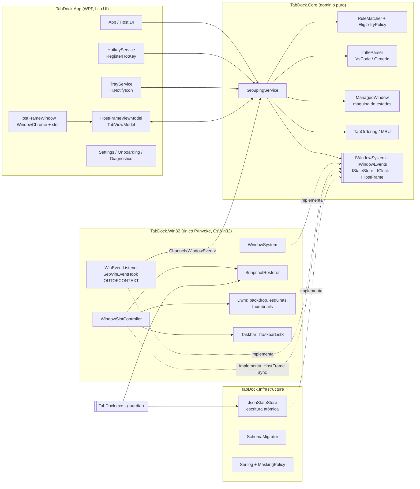
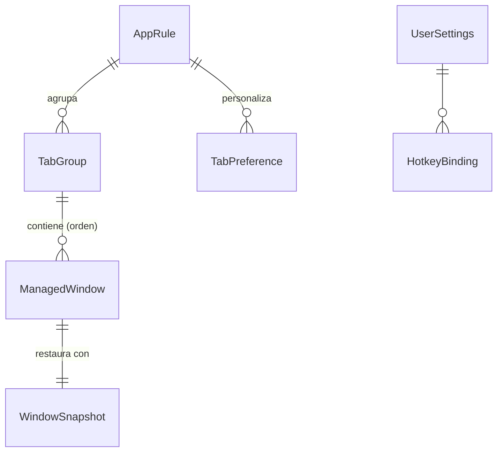
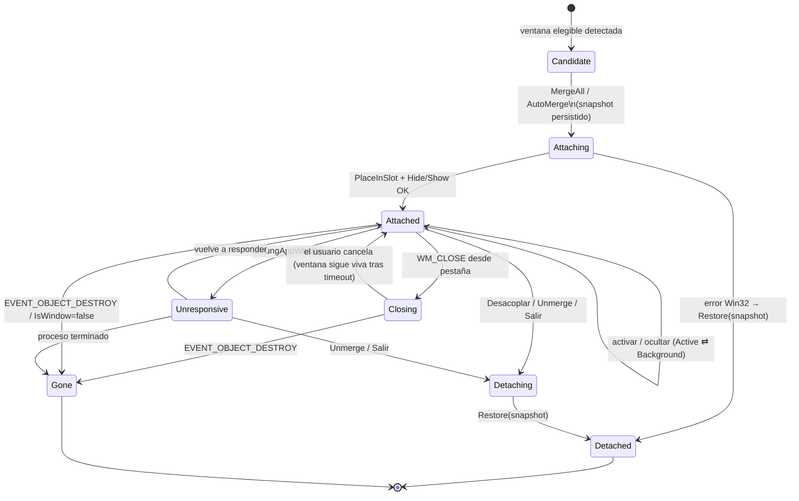

# TabDock — Arquitectura

## Estado actual (tras la Fase 8)

El plan de la Fase 0 sigue debajo como referencia; estas son las diferencias y piezas que se añadieron después.
Las decisiones están en `docs/DECISIONS/` (ADR 0001–0010).

### Capas y proyectos

| Proyecto | Contenido | Depende de |
|---|---|---|
| `TabDock.Core` (`net10.0`) | Dominio y servicios sin Win32 ni WPF: `TabGroupSession`, `GroupingService`, `RuleMatcher`, `EligibilityPolicy`, parsers de título, `SettingsService`, `TabPreferenceService`, `SnapshotRestorer`, `HotkeyValidator`, enmascaramiento de logs | Abstracciones de logging |
| `TabDock.Infrastructure` (`net10.0`) | JSON con escritura atómica y migraciones (`settings.json` esquema 2), logs Serilog enmascarados, exportación del diagnóstico | Core |
| `TabDock.Win32` (`net10.0-windows`) | CsWin32: ventanas, eventos (`SetWinEventHook`), DWM, barra de tareas, escritorios virtuales, atajos, monitores, inicio con Windows, región del hueco | Core |
| `TabDock.App` (WPF) | Marco, Ajustes, introducción, bandeja, coordinador, guardián, instalador (Velopack) | Todos |
| `TabDock.TestTarget` | Ventanas de prueba que imitan casos reales (VS Code/Chromium, colgadas, sin DPI, muchas ventanas, ráfagas) | — |

### Modelo de ventana (ADR 0001 + 0009)

- La ventana gestionada sigue siendo de nivel superior; nunca `SetParent`.
- El marco va **justo encima** de la ventana activa y tiene un **hueco** (`SetWindowRgn` sobre la ventana propia) del
  tamaño de su área visible, algo más pequeño para tapar la línea del borde. Por el hueco se ve y se hace clic en la
  ventana; su sombra queda bajo el marco.
- Las pestañas inactivas se ocultan con `SW_HIDE` (ADR 0002). Un solo botón en la barra de tareas por grupo (ADR 0007).
- El estado original de cada ventana se guarda en `state.json` **antes** de tocarla. Se restaura al separar, al salir,
  al cerrar sesión, por el guardián si TabDock muere, en el siguiente arranque y al desinstalar (ADR 0003, 0010).

### Flujo de eventos

`SetWinEventHook` (fuera de contexto) → `Channel` → hilo de UI → `FrameCoordinator` → `TabGroupSession.HandleEvent`.
Los eventos llegan con retraso y pueden ser ecos de las propias acciones de TabDock. Por eso cada decisión se basa en el
estado **actual** de la ventana (visible, en primer plano, viva) y no solo en el evento (ADR 0010).

### Configuración (ADR 0008)

`SettingsService` es la única fuente en ejecución: cada cambio se guarda en el acto y `SettingsApplier` lo aplica en
caliente (atajos, bandeja, tema, Mica, densidad, intervalo de comprobación). El idioma y el modo de bajo consumo se
aplican al reiniciar. Los argumentos de línea de comandos sustituyen a `settings.json` solo en esa ejecución.

### Distribución (ADR 0010)

`build/publish.ps1` publica (autocontenido, ReadyToRun, x64/arm64), firma con un certificado indicado por variables
de entorno y empaqueta con Velopack.

---

# Plan original (Fase 0)

> Documento de planificación. Las firmas C# eran **contratos de diseño**; algunos cambiaron al implementarse (ver arriba).

## 1. Diagrama de componentes



Reglas de dependencia: `Core` no referencia nada; `Win32` e `Infrastructure` referencian `Core`; `App`
referencia todo y compone en DI. `TabDock.TestTarget` no referencia nada del producto.

## 2. Modelo de hilos

- **Un único hilo de UI (Dispatcher WPF)** ejecuta todas las operaciones sobre ventanas y el `GroupingService`.
- `SetWinEventHook(..., WINEVENT_OUTOFCONTEXT)` se registra **desde el hilo UI** (el callback se entrega en el hilo
  que instaló el hook y necesita bucle de mensajes). El callback solo filtra (`OBJID_WINDOW`, `CHILDID_SELF`,
  HWND de interés o de proceso candidato) y escribe en un `Channel<WindowEvent>` sin bloquear.
- Un consumidor `async` en el Dispatcher lee el canal secuencialmente, aplica debounce (150 ms por HWND para
  `CREATE/SHOW/NAMECHANGE`) y coalescencia (`LOCATIONCHANGE` → solo el último por frame).
- Verificador periódico (`DispatcherTimer`, 2 s): `IsWindow` + `IsHungAppWindow` sobre ventanas gestionadas.

## 3. Contratos (puertos)

> **Actualización Fase 3:** los contratos implementados están en `src/TabDock.Core/Abstractions`. Cambios respecto a
> este borrador: los eventos son un único `WindowEvent(Kind, Handle)` con `WindowEventKind`; `IStateStore` se dividió
> y la parte de recuperación es `IRuntimeStateStore`; se usa `TimeProvider` en lugar de `IClock`; `IWindowSystem`
> añade `Matches(WindowIdentity)` y `PlaceBelow`. La orquestación de un grupo vive en `TabGroupSession` y la
> restauración compartida (guardián, arranque, emergencia) en `SnapshotRestorer`.

```csharp
namespace TabDock.Core.Abstractions;

public readonly record struct WindowHandle(nint Value);

public sealed record WindowInfo(
    WindowHandle Handle,
    int ProcessId,
    DateTimeOffset ProcessStartTime,
    string ExecutablePath,      // nunca se registra en claro
    string ClassName,
    string Title,               // nunca se registra en claro
    PixelRect ExtendedFrameBounds,
    bool IsVisible,
    bool IsCloaked,
    bool HasOwner,
    bool IsToolWindow,
    bool IsElevatedProcess,     // OpenProcess/OpenProcessToken falló por acceso o UIPI
    WindowShowState ShowState); // Normal | Minimized | Maximized

public interface IWindowSystem
{
    IReadOnlyList<WindowInfo> EnumerateTopLevel();
    Result<WindowInfo> GetInfo(WindowHandle hwnd);
    bool IsAlive(WindowHandle hwnd);
    bool IsHung(WindowHandle hwnd);

    Result<WindowSnapshot> CaptureSnapshot(WindowHandle hwnd);
    Result Restore(WindowSnapshot snapshot);

    Result Show(WindowHandle hwnd, bool activate);
    Result Hide(WindowHandle hwnd, HideMode mode);
    Result PlaceInSlot(WindowHandle managed, WindowHandle host, PixelRect slotBounds); // compensa bordes invisibles
    Result BringToForeground(WindowHandle hwnd);   // con reintentos 50/100/200 ms
    Result RequestClose(WindowHandle hwnd);        // PostMessage WM_CLOSE
}

public interface IWindowEvents : IDisposable
{
    IAsyncEnumerable<WindowEvent> ReadAllAsync(CancellationToken ct);
}

public abstract record WindowEvent(WindowHandle Handle, DateTimeOffset At);
public sealed record WindowCreated(WindowHandle Handle, DateTimeOffset At)       : WindowEvent(Handle, At);
public sealed record WindowShown(WindowHandle Handle, DateTimeOffset At)         : WindowEvent(Handle, At);
public sealed record WindowHidden(WindowHandle Handle, DateTimeOffset At)        : WindowEvent(Handle, At);
public sealed record WindowDestroyed(WindowHandle Handle, DateTimeOffset At)     : WindowEvent(Handle, At);
public sealed record WindowTitleChanged(WindowHandle Handle, DateTimeOffset At)  : WindowEvent(Handle, At);
public sealed record WindowMoved(WindowHandle Handle, DateTimeOffset At)         : WindowEvent(Handle, At);
public sealed record WindowForeground(WindowHandle Handle, DateTimeOffset At)    : WindowEvent(Handle, At);
public sealed record WindowMinimizeChanged(WindowHandle Handle, DateTimeOffset At, bool Minimized) : WindowEvent(Handle, At);
public sealed record WindowMoveSizeChanged(WindowHandle Handle, DateTimeOffset At, bool Started)  : WindowEvent(Handle, At);
public sealed record WindowCloakChanged(WindowHandle Handle, DateTimeOffset At, bool Cloaked)     : WindowEvent(Handle, At);

public interface IHostFrame                       // implementado por la App (adaptador del HostFrameWindow)
{
    Guid GroupId { get; }
    WindowHandle Handle { get; }
    PixelRect SlotBounds { get; }                 // píxeles físicos de pantalla
    event EventHandler? SlotBoundsChanged;
    void SetMaximized(bool maximized);
    void Close();
}

public interface IHostFrameFactory { IHostFrame CreateOrGet(TabGroup group); }

public interface IStateStore
{
    ValueTask<Result<SettingsDocument>> LoadSettingsAsync(CancellationToken ct);
    ValueTask SaveSettingsAsync(SettingsDocument doc, CancellationToken ct);
    ValueTask<Result<PreferencesDocument>> LoadPreferencesAsync(CancellationToken ct);
    ValueTask SavePreferencesAsync(PreferencesDocument doc, CancellationToken ct);
    Result<RuntimeState> LoadRuntimeState();          // síncrono: se usa en recuperación y guardián
    void SaveRuntimeState(RuntimeState state);        // síncrono y atómico: se llama ANTES de mover ventanas
}

public interface ITitleParser
{
    TitleParserKind Kind { get; }
    ParsedTitle Parse(string rawTitle, TitleParserOptions options);
}

public sealed record ParsedTitle(
    string ProjectName, string? ActiveFile, bool IsDirty,
    RemoteKind RemoteKind, string? RemoteLabel, string? ProfileName, bool IsEmptyWindow);

public interface IClock { DateTimeOffset UtcNow { get; } }
```

`Result`/`Result<T>`: tipo propio en `Core` con `Error(Code, MessageKey, Win32Error?)`; `MessageKey` apunta a
recursos localizados.

## 4. Modelo de datos



| Entidad | Persistencia | Campos clave | Notas |
|---|---|---|---|
| `AppRule` | `settings.json` | `Id`, `DisplayName`, `ExecutableName`, `ExecutablePathPattern?`, `WindowClassName?`, `TitleParserKind`, `Enabled`, `AutoMerge`, `MergeOnStartup`, `SidebarPosition`, `CreatedAt`, `UpdatedAt` | Regla VS Code predefinida (`Code.exe`, clase `Chrome_WidgetWin_1`, `vscode`). Variantes: `Code - Insiders.exe`, `VSCodium.exe`, `Cursor.exe`. |
| `TabGroup` | `state.json` (bounds y layout también en `preferences.json` por regla) | `Id`, `AppRuleId`, `ActiveTabId`, `Tabs`, `FrameBounds: Dictionary<MonitorDeviceId, Rect>`, `SidebarWidth`, `SidebarCollapsed`, `MruOrder` | Un grupo activo por `AppRule`. |
| `ManagedWindow` | memoria + `state.json` | `Id`, `Hwnd`, `ProcessId`, `ProcessStartTime`, `ExecutablePath`, `RawTitle`, `DisplayName`, `Subtitle`, `IsDirty`, `RemoteKind`, `State`, `SnapshotId` | Clave de identidad: `(Hwnd, ProcessId, ProcessStartTime)`. `RawTitle` nunca en logs. |
| `WindowSnapshot` | `state.json` | `Hwnd`, `ProcessId`, `ProcessStartTime`, `Placement` (flags, showCmd, ptMin, ptMax, rcNormal), `WasVisible`, `WasInTaskbar`, `HadCaption`, `CapturedAt` | `ProcessId+StartTime` añadido para no restaurar un HWND reutilizado por otro proceso. |
| `TabPreference` | `preferences.json` | clave `(AppRuleId, ProjectKey)`, `Alias?`, `ColorHex?`, `Pinned`, `Order`, `LastSeenAt`, `DeletedAt?` | `ProjectKey` = nombre de proyecto normalizado (NFC, minúsculas invariantes, trim). Índice `Dictionary` en memoria. |
| `HotkeyBinding` | `settings.json` | `Command`, `Modifiers`, `Key`, `Enabled` | |
| `UserSettings` | `settings.json` | `Theme`, `UseMica`, `Density`, `HideMode`, `StartWithWindows`, `Language`, `CheckForUpdates`, `SchemaVersion` | `CheckForUpdates` añadido (requisito de desactivar Velopack). |
| `RuntimeState` | `state.json` | `SchemaVersion`, `SessionId`, `OwnerProcessId`, `CleanShutdown`, `Groups`, `Snapshots` | Usado por recuperación y guardián. |

Persistencia: `System.Text.Json` con `JsonSerializerContext` (source generators), `UnmappedMemberHandling.Disallow`
en entrada, escritura en `*.tmp` + `File.Replace` (con `File.Move` si el destino no existe). Archivo corrupto →
`<nombre>.corrupt-<yyyyMMddHHmmss>` + valores por defecto + aviso localizado. Migraciones: `ISchemaMigration`
(`From`, `To`, `Apply(JsonNode)`), encadenadas y probadas con snapshots `Verify`.

Purga: preferencias con `LastSeenAt` > 90 días → se marca `DeletedAt`; en el siguiente arranque, las que tengan
`DeletedAt` se eliminan.

## 5. Máquina de estados de `ManagedWindow`



Sub-estado de `Attached`: `Active` (visible en el slot) | `Background` (oculta según `HideMode`).
Invariantes probadas:
1. Ninguna transición a `Detached` o `[*]` (salvo `Gone`) sin haber aplicado `Restore`.
2. A lo sumo una ventana `Active` por grupo.
3. `Attaching` solo se entra si el snapshot está persistido en `state.json`.
4. Transiciones inválidas devuelven `Result.Fail`, no lanzan.

## 6. Flujos (resumen técnico)

1. **MergeAll(appRuleId):** `EnumerateTopLevel` → `RuleMatcher` + `EligibilityPolicy` → idempotencia por clave →
   `CaptureSnapshot` de todas → `SaveRuntimeState` → `HostFrameFactory.CreateOrGet` → activa la ventana que
   estaba en primer plano (o la primera) → oculta el resto → orden según `TabPreference.Order`/pinned.
2. **Auto-merge:** `WindowCreated/Shown` → debounce 150 ms → `GetInfo` → elegible y regla `AutoMerge` → paso 1
   para una sola ventana; pasa a `Active`.
3. **Cambio de pestaña:** `Show(dest)` → `PlaceInSlot` → `BringToForeground` → `Hide(anterior)` (en ese orden para
   evitar parpadeo del fondo) → MRU.
4. **Título/cierre:** `TitleChanged` → parser → actualizar VM. `Destroyed` → `Gone` → activar MRU → grupo vacío ⇒
   cerrar marco.
5. **Unmerge/salida/recuperación:** `Restore` de cada snapshot en orden inverso de Z → `CleanShutdown=true` →
   `SaveRuntimeState`. Al arrancar, si `CleanShutdown=false`: restaurar antes de mostrar UI. Rutas cubiertas:
   `Application.Exit`, `AppDomain.UnhandledException`, `TaskScheduler.UnobservedTaskException`,
   `Dispatcher.UnhandledException`, `SessionEnding` (`WM_QUERYENDSESSION`), desinstalador Velopack
   (`--veloapp-uninstall` hook), guardián (ADR 0003).

### Comportamientos sincronizados (por defecto)

| Acción del usuario | Respuesta |
|---|---|
| Mueve/redimensiona el marco | `DeferWindowPos` sobre la ventana activa en el mismo ciclo |
| Mueve la ventana gestionada (arrastre de su barra) | El marco la sigue (`MOVESIZESTART/END` + `LOCATIONCHANGE`) |
| Maximiza la ventana gestionada (su botón o doble clic en su barra) | Se restaura y se alterna maximizar/restaurar el marco |
| Minimiza la ventana gestionada | Se minimiza el marco (y viceversa) |
| Cierra la ventana gestionada (su botón) | Se cierra esa ventana y desaparece su pestaña |
| Activa una ventana oculta desde fuera (CLI, Alt+Tab en `taskbarOnly`) | Se activa su pestaña |
| Arrastra una pestaña fuera de la barra | Desacoplar en la posición soltada |
| Ventana cambia a otro escritorio virtual (cloaked) | El marco se mueve a ese escritorio si la API lo permite (ver WIN32-NOTES) |

## 7. Riesgos principales

| Riesgo | Impacto | Mitigación |
|---|---|---|
| **Ventanas que quedan ocultas** tras crash | Crítico | Snapshot persistido antes de mover, guardián (ADR 0003), recuperación al arrancar, manejadores globales de excepción, pruebas de "kill -9" con TestTarget. |
| **Restricciones de foco** (`SetForegroundWindow` falla si TabDock no tiene la última entrada) | Alto | Solo activar en respuesta a entrada del usuario (clic en pestaña, `WM_HOTKEY`): en esos casos el proceso tiene derecho de foreground. Reintentos 50/100/200 ms. Sin `AttachThreadInput` ni simulación de teclas por defecto; si se necesita un truco, ADR propio. |
| **UIPI / ventanas elevadas** (VS Code "Ejecutar como administrador") | Medio | Detección (fallo de `OpenProcess`/`SetWindowPos` con `ERROR_ACCESS_DENIED`) → pestaña deshabilitada con aviso. Nunca se fuerza. |
| **DPI mixto** (marco en monitor 150 %, ventana en 100 %) | Medio | Manifiesto PMv2; cálculos en píxeles físicos; `PlaceInSlot` re-posiciona tras `WM_DPICHANGED` del marco y tras el cambio de DPI de la ventana gestionada (dos pasadas). Pruebas manuales multi-monitor. |
| **Escritorios virtuales** | Medio | `IVirtualDesktopManager` (pública) solo permite mover ventanas **propias**: se mueve el marco al escritorio de la ventana gestionada; no se pueden mover ventanas ajenas. Documentado. |
| **Reutilización de HWND** tras cierre | Medio | Clave `(Hwnd, ProcessId, ProcessStartTime)` en toda verificación. |
| **Doble chrome con VS Code** (barra propia de VS Code + marco) | Bajo/estético | Onboarding explicativo; opción experimental para quitar caption; investigar en Fase 4 ajustes de VS Code que reduzcan su barra (sin asumir nombres de opciones no verificados). |
| **Latencia en redimensionado en vivo** (Electron repinta tarde) | Bajo | `DeferWindowPos`, fondo del slot neutro; medir en Fase 8. |
| **Explorer re-añade botones** en `taskbarOnly` | Bajo | Re-aplicar en `TaskbarCreated` y en cambios de título. |
| **Otro software de gestión de ventanas** (PowerToys FancyZones, Groupy) | Bajo | Detectar conflictos de hotkeys; documentar incompatibilidades. |
| **Licencias**: FluentAssertions 8+ es comercial | Legal | Usar **Shouldly** (BSD). Inter (OFL), Lucide (ISC), Fluent System Icons (MIT). |

## 8. Plan de pruebas

Detallado en [TEST-PLAN.md](TEST-PLAN.md).
